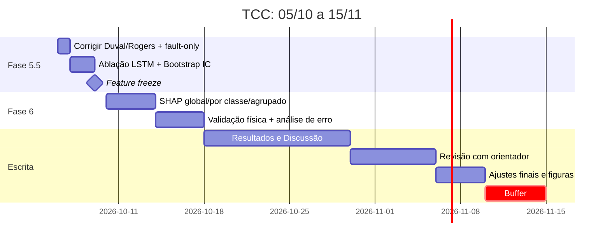

# Relatório de Decisão: Mais Features ou Fase 6?

**Data:** 05/10 · **Entrega:** 15/11 (41 dias) · **Fontes analisadas:** [analise_critica_features.md](file:///c:/Users/andriogabriel.eppin/.gemini/antigravity-ide/scratch/tcc-transformer-fault/analise_critica_features.md), [iga_track_a_results.json](file:///c:/Users/andriogabriel.eppin/.gemini/antigravity-ide/scratch/tcc-transformer-fault/reports/metrics/iga_track_a_results.json), [iga_track_b_results.json](file:///c:/Users/andriogabriel.eppin/.gemini/antigravity-ide/scratch/tcc-transformer-fault/reports/metrics/iga_track_b_results.json), [train_hybrid.py](file:///c:/Users/andriogabriel.eppin/.gemini/antigravity-ide/scratch/tcc-transformer-fault/src/iga_xgboost/train_hybrid.py), [traditional_methods.py](file:///c:/Users/andriogabriel.eppin/.gemini/antigravity-ide/scratch/tcc-transformer-fault/src/iga_xgboost/traditional_methods.py)

---

## 1. Veredito

> [!IMPORTANT]
> **Não crie mais features. Vá para a Fase 6.** Antes disso, faça uma **Fase 5.5 curta (3–4 dias)** com três correções que hoje são **pontos fracos reais para a banca**, e que pesam mais do que qualquer feature nova:
> 1. **Os baselines de Duval e Rogers estão implementados errado**, por isso os números deles estão artificialmente baixos.
> 2. **Falta a ablação do LSTM** no Track A. Hoje a hipótese central do sistema híbrido não está testada.
> 3. **A significância estatística está superestimada.** As diferenças entre os modelos do Track B estão dentro do ruído.

---

## 2. Status do `analise_critica_features.md`

As recomendações do documento **já foram implementadas** e os resultados atuais já as refletem:

| Recomendação | Status no código |
|---|---|
| Remover CO/C₂H₄ | ✅ Removida |
| TH, TH1 + 7 percentuais (Wu et al.) | ✅ Implementado no Track B |
| C₂H₂/C₂H₆ | ✅ Implementado |
| TH_katser + percentuais parciais | ✅ Implementado no Track A |
| H₂/C₂H₂ declarada como adaptação | ⚠️ **No texto do TCC**: confirmar que ela não aparece como "razão IEC" |

**Isso significa que a pergunta "vale explorar features?" já foi testada uma vez.** O teste foi passar de 9 para 19 features (+10, todas com base na literatura), e o ganho foi modesto e estatisticamente inconclusivo (ver §4).

---

## 3. Leitura crítica dos resultados

### 3.1 Track A (Katser, 4 classes)

| Config | Features | F1-macro teste (5 seeds) |
|---|:---:|:---:|
| C1: IGA-XGBoost | 8 | **0,8909 ± 0,0011** |
| C2: XGBoost default | 17 | **0,8911 ± 0,0034** |

- **O IGA não melhorou o desempenho no Track A.** O ganho é zero. A contribuição real é de **parcimônia**: menos 53% de features com o mesmo F1. O texto precisa dizer isso com essas palavras. Escrever "o IGA melhorou o modelo" seria falso.
- **O principal erro é Normal ↔ T1** (17 Normais preditos como T1, 8 T1 preditos como Normal). Faz sentido físico: uma falha térmica de baixa temperatura (<300 °C) gera pouco gás e se parece com o envelhecimento normal do óleo.
- **O IGA escolheu 4 features LSTM em 8, mas isso NÃO prova que o LSTM agrega valor.** `lstm_h28_H2` é, essencialmente, uma extrapolação suavizada de `obs_H2`, e as duas são muito correlacionadas. O GA pode escolher uma no lugar da outra por acaso. **Sem ablação, a frase "as previsões LSTM melhoram o diagnóstico" não tem sustentação.** Esse é o furo metodológico mais grave do trabalho hoje, porque é a hipótese do título.
- Inconsistência de texto: a docstring de `train_hybrid.py` diz "Aplica SMOTE", mas o código usa `sample_weight`. Garanta que a metodologia escrita descreva o que foi de fato executado.

### 3.2 Track B (base chinesa, 7 classes)

| Config | Features | F1-macro teste (5 seeds) |
|---|:---:|:---:|
| C3: IGA (nosso) | 16 | **0,797 ± 0,005** |
| T3: Replicação Wu 2021 | 14 | 0,783 ± 0,007 |
| C4: XGBoost default | 19 | 0,784 ± 0,006 |
| T2: Duval | — | 0,263 ⚠️ |
| T1: Rogers | — | 0,129 ⚠️ |

**Ponto 1: o ± está enganando.** O desvio de 5 seeds mede apenas a aleatoriedade do XGBoost. Ele não mede a incerteza amostral de um teste com 295 amostras e classes de 16 exemplos. Uma evidência direta disso é o mesmo modelo C3 ter F1 = **0,70 na validação e 0,79 no teste**: 9 pontos de diferença só por trocar de partição, contra 0,005 entre seeds. Um IC por bootstrap no teste provavelmente fica em torno de ±0,03–0,04. **Conclusão: C3, T3 e C4 são estatisticamente equivalentes.** A frase correta para o TCC é "o IGA alcança desempenho equivalente ao de Wu et al. com seleção automática". Escrever "supera Wu et al." não se sustenta.

**Ponto 2: os erros dominantes não são os que a gente imaginava.** Pela matriz de confusão do teste (C3):
- **D1 ↔ D2: 11 erros**, a maior fonte individual (15 erros na validação).
- T1/T2/T3: 4 T2→T1, 4 T3→T1, 3 T3→T2.
- Normal → T1: 4.

Todas essas confusões ficam **nas fronteiras de zona do próprio Triângulo de Duval e da IEC 60599**. Os rótulos da base foram atribuídos com critérios baseados nesses mesmos gases, então as amostras perto da fronteira são intrinsecamente ambíguas, ou seja, há ruído de rótulo. **Isso é um teto informacional, não falta de features.**

**Ponto 3: os baselines tradicionais estão errados. Isso é crítico.**

Um avaliador da área de DGA vai olhar "Duval = 30% de acurácia" e desconfiar na hora, porque a literatura reporta Duval entre ~70% e 90% em bases como a IEC TC10. Ao inspecionar [traditional_methods.py](file:///c:/Users/andriogabriel.eppin/.gemini/antigravity-ide/scratch/tcc-transformer-fault/src/iga_xgboost/traditional_methods.py#L140-L208):

| Zona | Implementado | Duval Triangle 1 (IEC 60599 Anexo B) |
|---|---|---|
| PD | %CH₄ > 80 | **%CH₄ ≥ 98** |
| T1 | %C₂H₄ < 10 | **%C₂H₄ < 20** (e %C₂H₂ < 4) |
| T2 | 10 ≤ %C₂H₄ ≤ 50 | **20 ≤ %C₂H₄ < 50** |
| D1 | %C₂H₂ ≥ 23 | **%C₂H₂ > 13 e %C₂H₄ < 23** |
| D2 | 13 ≤ %C₂H₂ < 23 | **%C₂H₄ ≥ 23 e %C₂H₂ > 29**, ou **23–40 / 13–29** |
| DT | mapeado para D1/D2 | zona própria: tratar como "não conclusivo" |

Os efeitos aparecem exatamente na matriz: D2→D1 em 24 de 33 amostras, T1 com recall 0 e Normal→PD em 83 de 106.

O **Rogers** ([L61-L122](file:///c:/Users/andriogabriel.eppin/.gemini/antigravity-ide/scratch/tcc-transformer-fault/src/iga_xgboost/traditional_methods.py#L61-L122)) cita "IEC 60599 Tabela 1", mas a tabela implementada é uma mistura de Rogers original com classes IEC (por exemplo, "T2 150–200 °C" não é a definição IEC de T2, que é 300–700 °C). Além disso, todo caso **não enquadrado vira "Normal"**, o que gera 87 Normais→T1 e, ao mesmo tempo, joga as falhas para a classe Normal.

Outro problema: **Normal não é zona de Duval nem de Rogers.** Esses métodos pressupõem que já existe uma falha. Com Normal incluída, a comparação é injusta por construção. É o mesmo tipo de risco que o documento de features apontou para CO/C₂H₄: **uma referência citada que não corresponde ao que foi implementado.**

---

## 4. Vale a pena criar features novas? Não. Os motivos:

**4.1 Argumento de teoria da informação (o principal).** Na base chinesa, *todas* as features (razões, TH, percentuais, Pentágono, entropia) são **funções determinísticas dos mesmos 5 números** (H₂, CH₄, C₂H₆, C₂H₄, C₂H₂). Uma feature derivada não adiciona informação nova. Ela só facilita o trabalho das árvores. Esse ganho de "facilitação" já foi colhido ao passar de 9 para 19 features, e foi pequeno. Informação nova de verdade viria de **medições novas** (CO, CO₂, O₂/N₂, temperatura do óleo, carga, idade), que a base não tem.

**4.2 Análise das propostas restantes do documento:**

| Proposta | Track | Ganho esperado | Comentário |
|---|:---:|:---:|---|
| Percentuais do Pentágono de Duval | B | ≈0 | Redundantes com X/TH1 + H₂, que já estão no modelo |
| Entropia de Shannon da composição | B | ≈0 | Um escalar que resume os mesmos percentuais. Base física fraca, difícil de defender |
| Taxa de variação (Δ/Δt) | B | — | **Impossível**: a base B é de snapshots, sem tempo |
| TDCG | A | ≈0 | Soma de features já presentes |
| Δ explícito `lstm_h28_X − obs_X` | A | pequeno | **A única com lógica** (árvores aprendem diferenças mal). O Track A já está em 0,89 e o erro é Normal↔T1. **Opcional, só dentro da ablação** |

**4.3 Custo de oportunidade.** Cada rodada nova de features exige reconstruir as features, rodar o IGA de novo nos dois tracks, refazer multi-seed, refazer as tabelas e revalidar. São 3–5 dias por ciclo, para um ganho esperado **menor que a incerteza estatística**, ou seja, impossível de demonstrar. Para a banca, um ganho de +0,01 em F1 não muda nada. Um SHAP bem interpretado fisicamente muda.

**4.4 Risco de overfitting no teste.** Iterar features olhando para o F1 de teste é *test-set snooping*. Com 16 amostras de T1 no teste, uma única amostra a mais acertada muda o F1-macro em ~0,01. Continuar otimizando aqui é ajustar ruído.

---

## 5. Plano: Fase 5.5 (obrigatória, curta)

| # | Tarefa | Por quê | Esforço |
|:-:|---|---|:-:|
| 1 | **Corrigir Duval** (zonas IEC corretas, DT como "não conclusivo") e **Rogers** (Tabela de razões IEC 60599: PD, D1, D2, T1, T2, T3, mais "não classificado" separado) | Credibilidade do baseline. Hoje é o ponto mais fácil de atacar | 0,5–1 dia |
| 2 | Avaliar os métodos tradicionais **também no subconjunto só de falhas** (6 classes) e reportar a **taxa de não-classificação** | Comparação justa. A não-cobertura é uma fraqueza real e citável dos métodos de razão | junto com o item 1 |
| 3 | **Ablação do LSTM (Track A):** C5 = XGBoost sem features `lstm_*` (default e IGA); opcional C6 = só `lstm_*` | **Testa a hipótese central do TCC.** Qualquer resultado pode ser defendido. O que não se defende é não ter testado | 0,5 dia |
| 4 | **IC por bootstrap** (1000 reamostragens do teste) para todos os F1, e **bootstrap pareado** para C3 vs T3 e C1 vs C5 | Substitui o "±seed" como medida de incerteza | 0,5 dia |
| 5 | (Opcional) Repeated Stratified K-Fold 5×5 no Track B para C3/T3/C4 | Responde à diferença de 0,70 na validação contra 0,79 no teste | 0,5–1 dia |

> [!WARNING]
> Se a ablação mostrar que **sem LSTM o F1 é igual**, isso **não derruba o TCC**, mas muda a narrativa: "as previsões LSTM fornecem informação de *tendência* que o IGA seleciona, mas o diagnóstico na base Katser é dominado pelo estado atual dos gases". O SHAP (Fase 6) passa a ser o lugar onde você mostra **quando** as features LSTM importam (por exemplo, por classe, ou em séries com tendência de subida). É melhor descobrir isso agora do que na defesa.

**Feature freeze: 09/10.** Depois dessa data, nenhuma alteração em features ou modelos.

---

## 6. Fase 6 (SHAP): o que precisa sair dela

- **TreeExplainer** nos modelos finais (C1 e C3), calculado sobre o **teste**.
- **Por classe**, não só global: o gráfico summary multiclasse esconde a física. Esperado: C₂H₂/TH dominando D1/D2, C₂H₄/TH1 e C₂H₄/C₂H₆ separando T1/T2/T3, H₂ e CH₄/H₂ para PD.
- **Validação física:** cruzar os gráficos de dependência com os limiares IEC e Duval (por exemplo, onde o SHAP de `ratio_C2H2_TH` muda de sinal, em comparação com o limite de 13% de Duval). **Essa é a contribuição de maior valor acadêmico disponível.**
- ⚠️ **Features correlacionadas** (TH, TH1, X/TH, X/TH1) dividem o crédito no SHAP. Reporte também o **SHAP agrupado** (Brutos / Razões IEC / Família TH / LSTM).
- Track A: SHAP das features `lstm_*` contra `obs_*`, que complementa a ablação.
- Análise de erro: SHAP das amostras **D1↔D2** e **Normal↔T1** mal classificadas, para sustentar o argumento de ambiguidade de fronteira.

---

## 7. Cronograma até 15/11

---

## 8. Como enquadrar as conclusões no TCC

| ❌ Evitar | ✅ Escrever |
|---|---|
| "O IGA melhora o XGBoost" | "O IGA reduz 53% das features (Track A) mantendo F1 equivalente" |
| "Superamos Wu et al. (2021)" | "Reproduzimos Wu et al. com desempenho estatisticamente equivalente (IC 95%)" |
| "O LSTM melhora o diagnóstico" | *(depende da ablação)* |
| "ML é 3× melhor que Duval" (com o baseline atual) | Comparação com o Duval corrigido, no subconjunto só de falhas, e a taxa de não-classificação |
| "T1/T2 erram por falta de dados" | "As confusões ficam nas fronteiras de zona IEC/Duval: ambiguidade intrínseca e teto informacional dos 5 gases" |
