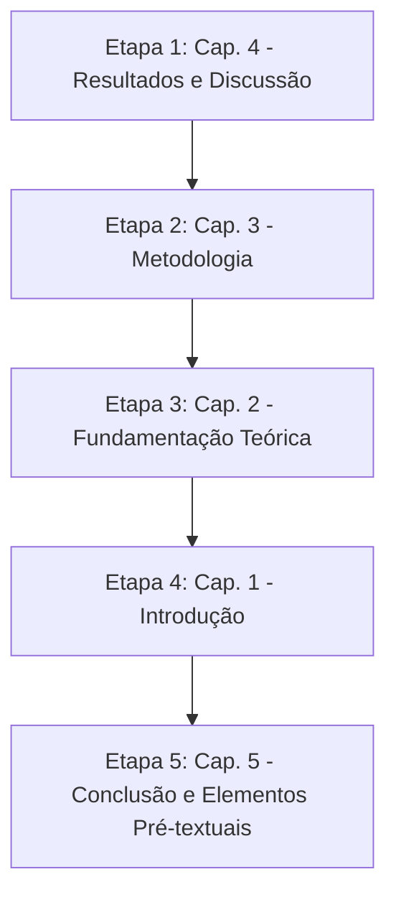

# 📋 Plano Estratégico de Escrita e Reestruturação — TCC II

**Autor:** Ândrio Gabriel Epping  
**Curso:** Engenharia da Computação — UNISINOS  
**Orientadora:** Profa. Me. Janaína Conceição Sutil Lemos  
**Papel:** Orientador Acadêmico Rigoroso & Revisor Técnico de Banca  
**Data:** Outubro de 2026  
**Documento Alvo:** Monografia Final de Graduação (`tcc-unisinos`)  
**Base Prática Auditada:** Experimentos, pipelines e métricas (`tcc-transformer-fault`)

---

## 1. Diagnóstico Executivo Geral

O projeto prático executado atingiu um nível de maturidade técnica, rigor estatístico e profundidade experimental notável:
- **Ablação com bootstrap pareado (5.000 iterações):** comprovação formal de hipóteses.
- **Avaliação de teto informacional:** validação via *Repeated Stratified K-Fold* $5\times 5$ (25 folds).
- **Auditoria físico-química de métodos tradicionais:** testes unitários e confronto direto com as normas IEC 60599 e Triângulo 1 de Duval.
- **Interpretabilidade analítica (XAI):** cálculo via TreeSHAP nativo aditivo, mitigação de colinearidade por agrupamento e extração de limiares físicos desnormalizados.

Contudo, **o texto atual (`tcc-unisinos`) é um fóssil do projeto preliminar (TCC I)**:
1. **Descompasso metodológico:** O texto descreve bases de dados que foram descartadas (Wang et al. 2023, simulação de Monte Carlo e Wu et al. com 430 amostras proprietárias).
2. **Promessas teóricas desmentidas pelos dados:** O texto ainda promete que a LSTM elevará o $F_1$-score de classificação. A ablação demonstrou que as previsões temporais têm correlação $r > 0,997$ com as concentrações atuais e geram $\Delta F_1$ com intervalo de confiança de 95% contendo o zero.
3. **Ausência da estrutura real em dois eixos:** O projeto foi bifurcado em **Track A** (temporal/Katser, 4 gases, 4 classes) e **Track B** (classificação multiclasse/China, 5 gases, 7 classes) devido à disponibilidade de variáveis. Isso é completamente omitido no texto atual.
4. **Capítulos ausentes:** O documento atual não possui os capítulos de *Resultados e Discussão* nem *Conclusão*, e a *Metodologia* está colada dentro do arquivo de fundamentação teórica redigida no tempo futuro.

---

## 2. Tabela de Auditoria das Seções Atuais

| Seção / Capítulo Atual | Status | Motivo Crítico da Mudança (ou "OK") |
| :--- | :---: | :--- |
| **Capa e Pré-textual (`main.tex`, `pretextual.tex`)** | **Ajustar** | Manter estrutura ABNT da UNISINOS. Atualizar resumo, abstract, palavras-chave e ano (2026/2). No título/resumo, calibrar a hibridização sob a ótica da parcimônia e investigação empírica rigorosa, evitando prometer ganhos artificiais de acurácia. |
| **1. Introdução (`introducao.tex`)** | **Reescrever** | **Desconexão com os achados:** Promete que a LSTM superará abordagens estáticas em acurácia diagnóstica. A introdução deve ser re-enquadrada como uma *investigação empírica da integração de projeções temporais e otimização evolutiva*, antecipando uma postura científica madura que valoriza a ablação e a parcimônia. |
| **1.1 Tema e 1.2 Justificativa** | **Ajustar** | Ajustar o problema para refletir a busca pela explicabilidade física e o desafio da heterogeneidade de rotulagem em bases de DGA. Retirar a premissa ingênua de que modelos estáticos falham unicamente por falta de dimensão temporal. |
| **1.3 Objetivos** | **Ajustar** | Ajustar os objetivos específicos: (i) investigar o valor incremental das projeções da LSTM via ablação pareada; (ii) quantificar o papel do IGA na redução de dimensionalidade; (iii) auditar a conformidade físico-química dos modelos frente à IEC 60599 e ao Triângulo de Duval via SHAP. |
| **1.4 Organização do Texto** | **Reescrever** | O texto atual descreve "próximos passos para o TCC II". Deve ser atualizado para refletir a estrutura monográfica final de 5 capítulos concluídos. |
| **2. Fundamentação Teórica (`fundamentacao.tex` L1–463)** | **Ajustar** | A base teórica de DGA, transformadores, LSTM e XGBoost está sólida. **Faltam adições cruciais:** (1) Fundamentação formal de XAI / TreeSHAP (valores de Shapley, aditividade e interações); (2) Definição geométrica formal do Triângulo de Duval 1 (IEC 60599 Anexo B) e das razões normativas; (3) Eliminar promessas de experimentos com Transformers (L349). |
| **3. Metodologia (em `fundamentacao.tex` L464–882)** | **Reescrever** | **Furo estrutural e metodológico grave:** Está fundida no mesmo arquivo `.tex` da fundamentação e redigida no tempo futuro. Deve ser desacoplada em `metodologia.tex`, documentando a divisão real em dois *Tracks*, o descarte justificado de bases proprietárias, o pipeline real de pré-processamento, a formulação do IGA via DEAP e o protocolo de bootstrap pareado com 5.000 iterações. |
| **3.11 Cronograma (`fundamentacao.tex` L821–882)** | **Eliminar** | Cronogramas de execução pertencem apenas à proposta do TCC I. Devem ser completamente removidos da monografia final. |
| **4. Considerações Finais (`fundamentacao.tex` L883–911)** | **Eliminar / Substituir** | O trecho atual é apenas um encerramento provisório de TCC I. Deve ser descartado para dar lugar ao Capítulo 5 (Conclusão) com as contribuições definitivas. |
| **Capítulo 4: Resultados e Discussão** | **A Criar do Zero** | **Totalmente inexistente no documento atual.** É o núcleo do trabalho, consolidando todos os achados das Fases 3, 5, 5.5, 5.6 e 6. |
| **Capítulo 5: Conclusão** | **A Criar do Zero** | Síntese de contribuições, defesa de resultados negativos com maturidade científica, limitações das bases e trabalhos futuros reais. |

---

## 3. Mapeamento de Tópicos e Subtópicos a Introduzir

### 3.1 No Capítulo 2 — Fundamentação Teórica (`fundamentacao.tex`)
- [ ] **2.X Interpretabilidade em Modelos de Aprendizado de Máquina (XAI)**
  - *2.X.1 Teoria dos Jogos Cooperativos e Valores de Shapley:* Definição axiomática (eficiência, simetria, monotonicidade e aditividade local).
  - *2.X.2 TreeSHAP e Decomposição de Contribuições:* Algoritmo de Lundberg para árvores, `pred_contribs` (margem em log-odds), diferença entre contribuição marginal e fronteira de decisão, e matriz de interações (`pred_interactions`).
  - *Justificativa:* Sem essa seção, os 14 gráficos de SHAP do Capítulo 4 tornam-se figuras heurísticas sem embasamento matemático formal.
- [ ] **2.Y Métodos Normativos de Diagnóstico em DGA**
  - *2.Y.1 Triângulo 1 de Duval (IEC 60599 Anexo B):* Coordenadas triangulares baseadas em $\%CH_4$, $\%C_2H_4$ e $\%C_2H_2$, definição exata dos polígonos de zona (PD, T1, T2, T3, D1, D2) e tratamento da zona de transição (DT).
  - *2.Y.2 Método das Razões da IEC 60599:* Tabela 1 de códigos de razões ($C_2H_2/C_2H_4$, $CH_4/H_2$, $C_2H_4/C_2H_6$) e especificação formal de casos "Não Determinados" (ND).
  - *Justificativa:* Essencial para sustentar a auditoria de concordância empírica e os testes unitários no Capítulo 4.

---

### 3.2 No Capítulo 3 — Metodologia (`metodologia.tex` — criação autônoma)
- [ ] **3.1 Desenho Metodológico e Arquitetura em Dois *Tracks***
  - Formalização do motivo da divisão: incompatibilidade de variáveis entre séries temporais públicas (Katser: 4 gases, sem $CH_4$ e $C_2H_6$) e bases estáticas de 7 classes (chinesa: 5 gases).
  - *Track A:* Avaliação longitudinal, previsão com LSTM e teste de ablação da hipótese temporal (4 classes).
  - *Track B:* Benchmark multiclasse estático (7 classes), comparação normativa com IEC/Duval e validação físico-química via XAI.
- [ ] **3.2 Bases de Dados e Procedimentos de Auditoria**
  - *3.2.1 Base Katser et al. (2022) — Track A:* 3.000 séries temporais (2.100 treino, 900 teste oficial), 420 pontos a cada 12 h, ambiente industrial (Skoltech/Rosatom). Registro da escala reduzida dos gases (ordem de $10^{-3}$) e implicações.
  - *3.2.2 Base Compilada de Classificação — Track B:* Proveniência pública, 2.321 amostras originais, **processo de deduplicação mandatória de 349 instâncias duplicadas (15%)**, resultando em 1.972 amostras únicas e não viesadas.
  - *3.2.3 Justificativa do Descarte de Bases Anteriores:* Documentar a indisponibilidade real da base proprietária de Wang et al. (2023), as divergências na citação da base de Wu et al. (2021) e o abandono de dados sintéticos por Monte Carlo.
- [ ] **3.3 Pré-processamento e Engenharia de Atributos**
  - *3.3.1 Normalização:* Aplicação de `log1p` para mitigar assimetria extrema (ex.: $H_2$ até 92.600 ppm) seguido de `MinMaxScaler` fitado exclusivamente nas dobras de treinamento.
  - *3.3.2 Vetor de Atributos do Track A (17 features):* 4 gases observados, razões adaptadas ($C_2H_2/C_2H_4$, $H_2/C_2H_2$), soma total de hidrocarbonetos adaptada ($TH_{katser}$), razões de percentual e 8 features preditivas da LSTM ($h=14$ e $h=28$).
  - *3.3.3 Vetor de Atributos do Track B (19 features):* 5 gases observados, razões IEC 60599, coordenadas do Triângulo de Duval (família $TH$) e razões estendidas de Wu et al. (família $TH_1$).
  - *3.3.4 Tratamento do Desbalanceamento:* Justificativa do uso de `sample_weight` no treinamento multiclasse e `CustomSMOTE` mantendo a consistência física das razões derivadas.
- [ ] **3.4 Módulo de Previsão Temporal (LSTM — Track A)**
  - Janelas deslizantes com $w=50$ passos (25 dias de histórico), horizontes $h=14$ (7 dias) e $h=28$ (14 dias), LSTM empilhada de 2 camadas recorrentes, otimizador Adam e parada antecipada (*early stopping*).
- [ ] **3.5 Algoritmo Genético Melhorado (IGA) e XGBoost**
  - Representação cromossômica mista (máscara binária de atributos + genes contínuos de hiperparâmetros), operadores genéticos com diversidade adaptativa, elitismo e função de aptidão com validação cruzada 5-fold (otimização do $F_1$-macro).
- [ ] **3.6 Protocolo de Avaliação Estatística e Ablação**
  - *3.6.1 Desenho Experimental do Track A (Ablação LSTM):* Configurações C1 (IGA completo), C2 (Default completo), C5a (Default sem LSTM), C5b (IGA sem LSTM) e C6 (Somente previsões LSTM).
  - *3.6.2 Desenho Experimental do Track B:* Configurações C3 (IGA), C4 (Default), T3 (Replicação Wu et al. 2021), T2 (Triângulo de Duval) e T1 (Razões IEC 60599).
  - *3.6.3 Rigor Estatístico:* Protocolo de bootstrap pareado com 5.000 iterações (IC95% da diferença pareada de $F_1$) e validação cruzada repetida (*Repeated Stratified K-Fold* $5\times 5$, 25 avaliações) para demonstrar o teto informacional.
- [ ] **3.7 Protocolo de Interpretabilidade e Validação Físico-Química**
  - Pipeline de cálculo do TreeSHAP nativo, teste de estabilidade de ranking (Spearman entre seeds), agrupamento de atributos colineares em 4 famílias, inversão de escala para unidades físicas e mapeamento espacial de erros no Triângulo de Duval.

---

### 3.3 No Capítulo 4 — Resultados e Discussão (`resultados.tex` — criação do zero)
- [ ] **4.1 Desempenho do Módulo de Previsão Temporal (LSTM)**
  - Tabela de métricas (MAE e RMSE em escala normalizada e desnormalizada em ppm por gás).
  * Análise de degradação do $R^2$ com o aumento do horizonte de previsão ($h=1$ a $h=28$).
- [ ] **4.2 Resultados do Track A: Desempenho e Ablação da Hipótese Temporal**
  - Tabela comparativa dos modelos (C1, C2, C5a, C5b, C6) com $F_1$-macro e intervalos de confiança (IC95%).
  - **Discussão Crítica:** Comprovação da forte colinearidade ($r > 0,997$) entre gases observados e previstos. O teste pareado revela que a inclusão das projeções da LSTM não traz ganho estatisticamente significativo ($\Delta F_1 = +0,0056$; IC $[-0,0037; +0,0150]$, cruzando o zero).
  - Demonstração da contribuição do IGA: obtenção de desempenho idêntico com redução de 53% das features (17 para 8 atributos).
  - Análise da confusão predominante Normal $\leftrightarrow$ T1 justificada pela baixa taxa de geração de gás em falhas térmicas incipientes.
- [ ] **4.3 Resultados do Track B: Diagnóstico Multiclasse e o Teto Informacional**
  - Tabela comparativa entre C3 (IGA), C4 (Default), T3 (Wu et al. 2021), T2 (Duval) e T1 (IEC).
  - Comprovação do teto informacional via Repeated $5\times 5$ CV: C3 ($0,7516$), C4 ($0,7616$) e T3 ($0,7654$) são estatisticamente indistinguíveis.
  - Discussão dos pontos fracos do modelo: sensibilidade de T1 e T2 e confusão mútua D1 $\leftrightarrow$ D2 nas fronteiras de energia.
- [ ] **4.4 Auditoria Normativa: Por que os Métodos Tradicionais Divergem?**
  - Tabela de concordância entre os rótulos empíricos da base e as previsões da IEC 60599 e do Triângulo de Duval.
  - Demonstração de que o baixo desempenho dos métodos tradicionais não é falha de implementação (validada por testes unitários), mas reflete a heterogeneidade e ruído de rotulagem de bases compiladas multi-fonte.
  - A anomalia da classe T3: mediana da razão $C_2H_4/C_2H_6 = 0,25$ na base, contradizendo a assinatura termodinâmica da IEC que exige valores $> 4$.
- [ ] **4.5 Interpretabilidade Físico-Química via SHAP**
  - *4.5.1 Estabilidade do Ranking Global:* Spearman $\rho = 0,963$ entre sementes.
  - *4.5.2 Heatmap Multiclasse e SHAP Agrupado:* Validação física da atuação dos gases (derivados de acetileno regendo descargas D1/D2, metano/hidrogênio em PD e etileno/etano nas térmicas).
  - *4.5.3 Extração de Limiares Físicos:* Identificação do cruzamento de zero do efeito principal desnormalizado comparado aos cortes normativos (ex.: $\%C_2H_4$ para D1 na faixa de 20–25% coincidindo com os 23% de Duval).
  - *4.5.4 Visualização Espacial no Triângulo de Duval:* Plotagem do conjunto de teste evidenciando que os erros de classificação concentram-se nas zonas de fronteira e transição.
  - *4.5.5 Análise de Casos com Waterfall Plots:* Inspeção detalhada de instâncias de erro (D1 $\rightarrow$ D2 e Normal $\rightarrow$ T1).
  - *4.5.6 Fechamento da Hipótese Temporal:* O gráfico de migração de crédito do SHAP (Fig. 7), provando a alternância arbitrária entre features observadas e simuladas.

---

### 3.4 No Capítulo 5 — Conclusão (`conclusao.tex` — criação do zero)
- [ ] **5.1 Síntese das Contribuições:** Modelo auditado, protocolo experimental reprodutível, estudo ablativo formal e ponte inédita entre árvores de decisão e a física das normas de DGA.
- [ ] **5.2 Defesa Científica de Resultados Negativos:** A relevância acadêmica de provar que a extrapolação temporal de curto prazo não agrega informação discriminativa para diagnósticos de estado estacionário.
- [ ] **5.3 Limitações do Trabalho:** Ausência de base pública unificada com séries temporais de 7 gases e limitações de amplitude das séries do Katser.
- [ ] **5.4 Recomendações e Trabalhos Futuros:** Reformulação do problema para prognóstico contínuo de vida útil remanescente (RUL) e transição de estados de falha.

---

## 4. Inventário de Dados e Figuras a Integrar

Todas as evidências numéricas e visuais já se encontram geradas no diretório `tcc-transformer-fault`:

### Tabelas Numéricas Obrigatórias:
1. **Tabela de Desempenho da LSTM:** MAE, RMSE e $R^2$ por gás e agregado (`reports/metrics/lstm_test_results_norm.json`).
2. **Tabela de Ablação do Track A:** Comparação C1, C2, C5a, C5b e C6 com métricas pontuais, $\sigma_{seeds}$ e IC95% do bootstrap pareado (`reports/metrics/fase55_track_a.json`).
3. **Tabela de Desempenho do Track B:** C3, C4, T3, T2 e T1 com métricas de teste e validação cruzada repetida $5\times 5$ (`reports/metrics/fase56.json`).
4. **Tabela de Concordância Rótulo $\times$ Norma:** Percentuais de concordância e distribuição de erros para Duval e IEC 60599 (`reports/metrics/fase56.json`).
5. **Tabela de Limiares Físicos SHAP:** Comparação entre os limiares empíricos extraídos das árvores e os cortes normativos da IEC e Duval.

### Figuras Essenciais a Incluir no LaTeX:
| Arquivo da Figura no Projeto | Seção Destino | Conteúdo / Papel no Argumento |
| :--- | :---: | :--- |
| `reports/figures/lstm_multi_horizon_r2_norm.png` | Cap. 4 (§4.1) | Queda de previsibilidade do $R^2$ conforme o horizonte $h$ avança. |
| `reports/figures/xgb_confusion_track_a.png` | Cap. 4 (§4.2) | Matriz de confusão do Track A mostrando a confusão Normal $\leftrightarrow$ T1. |
| `reports/figures/xgb_tradeoff_complexity.png` | Cap. 4 (§4.2) | Trade-off complexidade $\times$ desempenho (parcimônia do IGA). |
| `reports/figures/xgb_confusion_track_b.png` | Cap. 4 (§4.3) | Matriz de confusão de 7 classes destacando o gargalo D1 $\leftrightarrow$ D2. |
| `reports/figures/fase6/fig1_heatmap_track_b.png` | Cap. 4 (§4.5) | Heatmap de importância global de features por classe. |
| `reports/figures/fase6/fig2_grouped_track_b.png` | Cap. 4 (§4.5) | Importância agrupada em 4 famílias (resolução de colinearidade). |
| `reports/figures/fase6/fig3_beeswarm_D1.png` (e demais) | Cap. 4 (§4.5) | Beeswarm individual evidenciando o papel de cada gás. |
| `reports/figures/fase6/fig4_thresh_ratio_C2H4_TH_D1.png` | Cap. 4 (§4.5) | Transição do efeito principal em escala física (%C$_2$H$_4$). |
| `reports/figures/fase6/fig5_duval_triangle.png` | Cap. 4 (§4.5) | Triângulo de Duval do teste com erros plotados nas fronteiras. |
| `reports/figures/fase6/fig6_waterfall_error_D1_to_D2_11.png` | Cap. 4 (§4.5) | Waterfall plot de instância individual justificando erro de fronteira. |
| `reports/figures/fase6/fig7_lstm_credit_migration.png` | Cap. 4 (§4.5) | Migração de crédito entre $obs$ e $lstm$, fechando a tese do LSTM. |

---

## 5. Roteiro Lógico e Sequencial de Escrita

Para garantir eficiência máxima e consistência argumentativa, execute a redação nesta ordem exata:

### Passo 1: Redigir o Capítulo 4 (Resultados e Discussão)
* **Objetivo:** Estabelecer os fatos definitivos da monografia. Como todos os números e gráficos já existem, redigir esta seção primeiro blinda o restante do trabalho contra especulações.
* **Ações:**
  1. Criar o arquivo `tcc-unisinos/resultados.tex`.
  2. Inserir as tabelas consolidadas das Fases 5.5 e 5.6.
  3. Estruturar os blocos argumentativos na ordem: Desempenho LSTM $\rightarrow$ Ablação Track A $\rightarrow$ Diagnóstico Track B e Teto Informacional $\rightarrow$ Auditoria Normativa $\rightarrow$ XAI com TreeSHAP.

### Passo 2: Redigir o Capítulo 3 (Metodologia)
* **Objetivo:** Documentar fielmente a rota percorrida para gerar os resultados do Capítulo 4.
* **Ações:**
  1. Criar o arquivo `tcc-unisinos/metodologia.tex` (extraindo e descartando o trecho preliminar de `fundamentacao.tex`).
  2. Formalizar os dois *Tracks* (A e B).
  3. Descrever as etapas reais de pré-processamento, parametrização do IGA e protocolo de bootstrap pareado.

### Passo 3: Ajustar o Capítulo 2 (Fundamentação Teórica)
* **Objetivo:** Fornecer suporte conceitual estrito às ferramentas aplicadas nos Capítulos 3 e 4.
* **Ações:**
  1. Revisar `tcc-unisinos/fundamentacao.tex`, mantendo apenas o conteúdo teórico.
  2. Adicionar as seções de formulação matemática de TreeSHAP e definições geométricas formais do Triângulo 1 de Duval e IEC 60599.
  3. Remover menções a cronogramas.

### Passo 4: Reescrever o Capítulo 1 (Introdução)
* **Objetivo:** Conectar a motivação da pesquisa aos achados reais.
* **Ações:**
  1. Reescrever `tcc-unisinos/introducao.tex`.
  2. Enquadrar o trabalho como uma investigação empírica rigorosa de hibridização, auditoria e interpretabilidade.
  3. Alinhar os objetivos específicos exatamente com o que foi demonstrado.
  4. Atualizar a seção de organização do texto para 5 capítulos.

### Passo 5: Redigir o Capítulo 5 (Conclusão) e Elementos Pré-textuais
* **Objetivo:** Fechar o trabalho com chave de ouro, demonstrando maturidade científica.
* **Ações:**
  1. Criar `tcc-unisinos/conclusao.tex`.
  2. Sintetizar as contribuições, discutir abertamente os resultados negativos e apontar limitações e trabalhos futuros reais.
  3. Atualizar resumo, abstract e o arquivo mestre `tcc-unisinos/main.tex` incluindo todos os arquivos `.tex` via `\include{}`.

---

## 6. Guia de Defesa e Postura perante a Banca

Durante a arguição final, a banca costuma concentrar-se em pontos sensíveis. Esteja preparado com as respostas padronizadas abaixo:

1. **"Por que usar IGA se o XGBoost padrão atinge desempenho estatisticamente idêntico?"**
   * *Resposta:* O ganho do IGA não é de acurácia pura, mas de **parcimônia e redução de dimensionalidade**. No Track A, o modelo reduziu o espaço de atributos em 53% (de 17 para 8 features) mantendo o mesmo $F_1$-score. Isso simplifica o monitoramento online em ambiente de produção industrial.
2. **"Por que a inclusão das projeções da LSTM não elevou o diagnóstico de falhas?"**
   * *Resposta:* A análise de correlação cruzada comprovou que $r > 0,997$ entre as previsões e os gases observados em janelas de 7 a 14 dias. Em um cenário onde o transformador já opera em estado estacionário ou degradação lenta, a concentração atual carrega quase toda a informação necessária para o diagnóstico instantâneo. A LSTM agrega valor para *prognóstico de tendência futura*, mas não para discriminação diagnóstica do estado presente.
3. **"Por que o Triângulo de Duval e a IEC 60599 obtiveram taxas de acurácia tão baixas na base de dados?"**
   * *Resposta:* Nossa auditoria físico-química demonstrou que as regras normativas estão matematicamente corretas (validadas por testes unitários em pontos canônicos), mas a base de dados compilada apresenta divergências de rotulagem em relação às normas internacionais. Na classe T3, por exemplo, a mediana da razão $C_2H_4/C_2H_6$ é de $0,25$, enquanto a termodinâmica da IEC exige $> 4$. O modelo de aprendizado de máquina adaptou-se à convenção empírica da base, expondo as limitações de generalização de datasets heterogêneos.
4. **"Como você garante que o modelo aprendeu a física do problema e não apenas ruído estatístico?"**
   * *Resposta:* A análise com TreeSHAP comprovou alinhamento quase perfeito entre o comportamento do modelo e a termodinâmica de degradação: o acetileno domina descargas de alta energia (D1/D2), o metano domina descargas parciais (PD) e o etileno domina falhas térmicas. Além disso, o limiar de inversão da contribuição de $\%C_2H_4$ para D1 foi aprendido autonomamente pelo modelo na faixa de 20–25%, coincidindo com a fronteira exata de 23% do Triângulo de Duval.
